<div align="center">

# Zyven

**Agents that compile their own tools.**

Zyven turns open-source code into verified MCP tools that an AI agent learns when it needs them, and keeps
only after they pass a locked-down sandbox.

**Demo video:** [watch it on Google Drive](https://drive.google.com/drive/folders/17Z5dbSa2UQmzx8eyQ6716iMhUfkipIRD)

[](https://github.com/VirajSawad1021/Zyven/actions/workflows/ci.yml)


Frogtoberfest 2026 entry

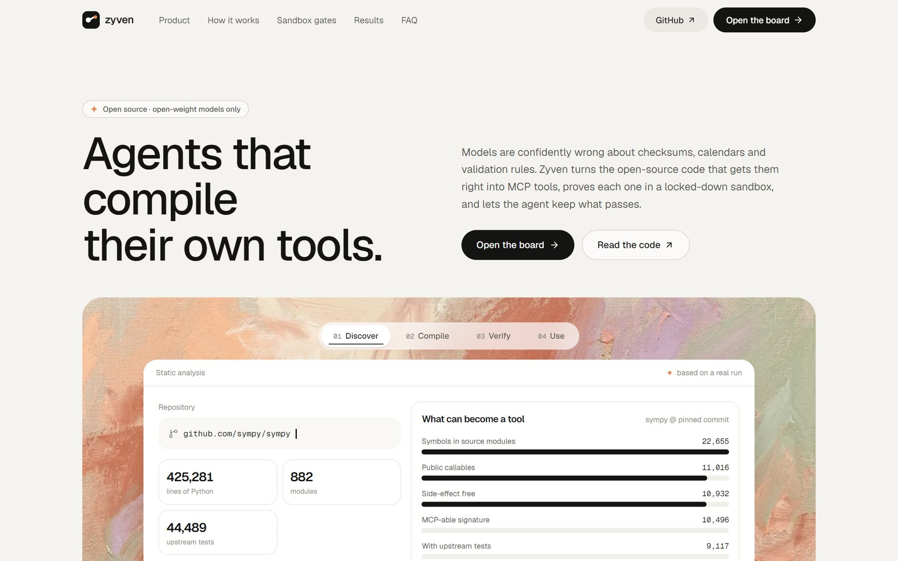

</div>

## Why

Language models are confidently wrong about things that need exact logic: check digits, calendar conversions,
validation rules, lookups. The correct, tested code for these already exists in open-source libraries, but an agent
can't use it until someone hand-builds a tool around it.

Zyven does that step automatically, and refuses to hand over anything it can't prove:

1. **Discover.** Read a repository's source with static analysis, never running it: public functions, call graph,
   tests, side effects, license.
2. **Compile.** Open-weight model roles propose a small MCP server around the library. Every name they write is
   checked against the analysis, so invented functions are rejected.
3. **Verify.** Six gates run in a Docker sandbox with no network. One of them compares every tool's answer with the
   library called directly.
4. **Use.** The agent hot-loads the verified skill mid-task and keeps it. The next task that needs it reuses it in
   seconds instead of compiling for minutes.

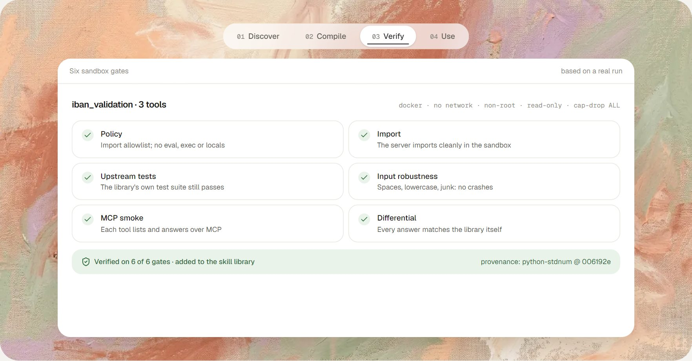

*The IBAN skill's gates, from an earlier build of the app.*

## Results

Every run uses the open-weight model `gemma-4-26b-a4b-it`, with the same tasks and budget in each condition. Ground
truth is computed by the source library itself, and the raw records are in `eval/results/`.

| Suite | Source | Model alone | Model + Zyven-compiled skills |
|---|---|---|---|
| IBAN validity, IBAN check digits, Luhn | [python-stdnum](https://github.com/arthurdejong/python-stdnum) | **0 / 18** | **18 / 18** |
| Hijri ↔ Gregorian, Jewish holidays, phone validity and E.164 | [hijridate](https://github.com/dralshehri/hijridate), [pyluach](https://github.com/simlist/pyluach), [phonenumbers](https://github.com/daviddrysdale/python-phonenumbers) | **18 / 30** | **27 / 30*** |
| Bikram Sambat dates, weekdays, phone operators | [py-nepali](https://github.com/opensource-nepal/py-nepali) | **9 / 40** | **40 / 40** |

<details>
<summary>Per-category breakdown</summary>

**python-stdnum** (366 modules)

| Condition | IBAN valid? | IBAN check digits | Card number passes Luhn? | Total |
|---|---|---|---|---|
| Model alone | 0/6 | 0/6 | 0/6 | **0/18** |
| Model + compiled skills | 6/6 | 6/6 | 6/6 | **18/18** |

**Calendars and phone numbers**

| Condition | Hijri → Greg | Greg → Hijri | Jewish holiday | Phone valid? | Phone → E.164 | Total |
|---|---|---|---|---|---|---|
| Model alone | 2/6 | 3/6 | 3/6 | 5/6 | 5/6 | **18/30** |
| Model + compiled skills | 6/6 | 6/6 | 3/6* | 6/6 | 6/6 | **27/30** |

**py-nepali** (Bikram Sambat calendar)

| Condition | Date conversions · weekday · phone operator | Total |
|---|---|---|
| Model alone | 2/10 · 0/10 · 1/10 · 6/10 | **9/40** |
| Model + hand-written skill | 10/10 each | **40/40** |
| Model + compiled skills | 10/10 each | **40/40** |

**networkx** (graph algorithms, `gemma-4-26b-a4b-it`, skill compiled by `gemma-4-31b-it`)

| Condition | Output cap | Questions | Total |
|---|---|---|---|
| Model alone | 4096 tokens | 24 | **1/24** |
| Model + compiled skill | 4096 tokens | 24 | **19/24** |
| Model alone | 8192 tokens | 12 | **3/12** |
| Model + compiled skill | 8192 tokens | 12 | **11/12** |

At the 4096-token cap, 23 of 24 runs without the skill used up the budget working the answer out by hand and gave none,
and all 5 misses with the skill were the same cap, not wrong tool results. Doubling the cap helps both conditions; the
skill still adds the most (3/12 to 11/12). The second run is a smaller sample (12 questions per condition), so read
it as a direction. A check with a second model through the Qoder CLI (5 questions per condition, dev only, not
counted here) pointed the same way. Details are in `eval/results/run-20261025-150806.md` and
`eval/results/run-20261025-170753.md`.

</details>

\*There was no Jewish-holiday skill in this run: the hosted endpoint timed out on that compile, so that category ran
without a skill in both conditions. Details are in `eval/results/global-open-model.md`.

Without tools, the model tries to compute checksums and calendars by hand and usually runs out of budget.

**How to read these numbers.** The baseline is the model alone, not the model with a Python interpreter, the suites are small
and were developed against these libraries, and the 4096-token cap decides much of the baseline (see
[`LIMITATIONS.md`](LIMITATIONS.md) section 5). A model-plus-interpreter baseline and a held-out suite are open
([#24](https://github.com/VirajSawad1021/Zyven/issues/24), [#25](https://github.com/VirajSawad1021/Zyven/issues/25)).

### What the gates caught during development

- **Differential gate:** merged imports in a generated server made the "Luhn" tool silently run a different
  checksum algorithm. Every other gate passed. The comparison with the library failed 3 of 8 cases, and the build
  now scopes imports per tool.
- **Input robustness:** a card-number tool crashed on `4992 7398 71` (with spaces). The Repair role fixed it.
- **Partial verification:** an IBAN check-digit tool that could not be repaired was dropped from the package
  instead of being shipped unverified.

## The app

`zyven board` serves the landing page, the board and the APIs on one port. The screenshots below are the real app
on a clean board (`zyven board --board-dir …`) where every model call was made by the open-weight
`gemma-4-26b-a4b-it`.

**Task board.** Give the agent a task. When it lacks a capability it proposes a pinned repository, waits for your
approval, compiles in the sandbox and finishes the task with the new tool. Anything risky waits for your click.

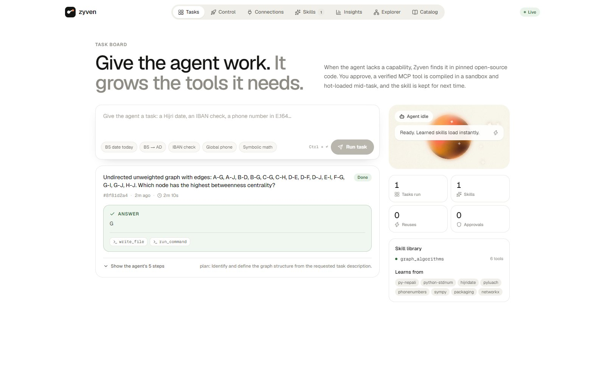

*The current board, with the verified `graph_algorithms` skill in its library. The agent can also solve a task with its
own code in a sandbox, as it did here, so whether it goes to the catalog is the model's judgement (see
`LIMITATIONS.md`).*

An earlier run on the same board showed the compile-then-reuse loop: the first IBAN task compiled a skill from
python-stdnum (366 modules) in 2 minutes, the second reused it and finished in 19 seconds, and a UK phone number the
model could answer on its own needed no tool at all.

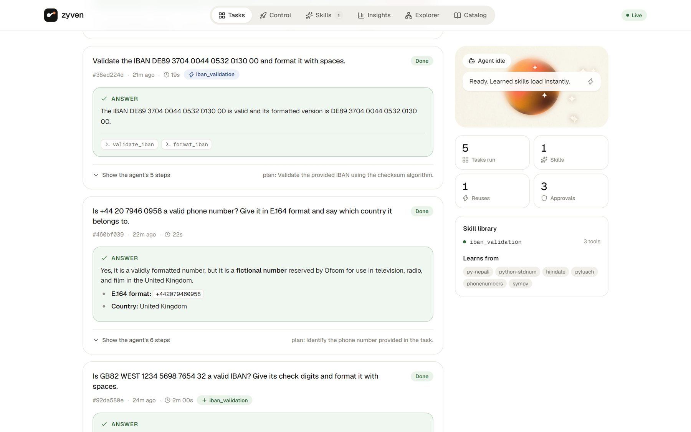

**A finished task.** The answer, the tool calls that produced it, the skill learned from the repository, and the six
sandbox gates it passed. Answers render as Markdown, with maths when there is any.

<p align="center">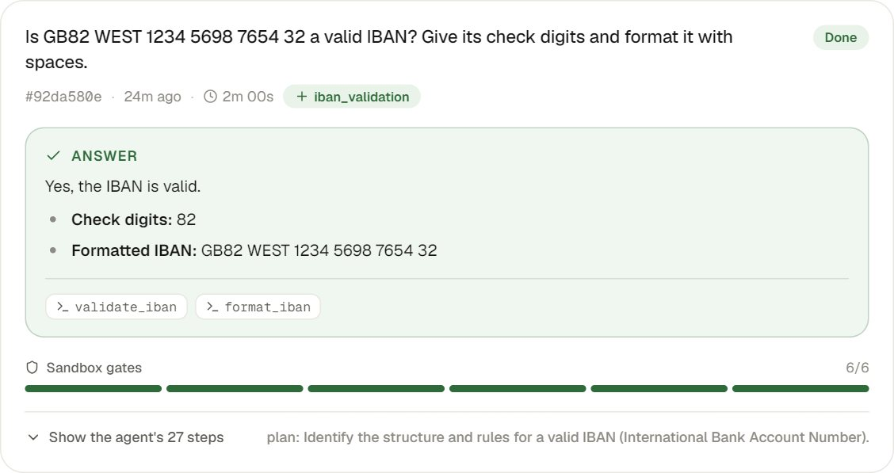</p>

**Insights.** The learning curve, measured: how much faster a reuse is than a compile, every task on a log-scale
timeline, skill-library growth, and a grid of which gate stopped each compile attempt. In this run, a phone-number skill
compiled from python-phonenumbers passed the library's own 158 tests, but the differential gate caught one tool
disagreeing with the library on a UK mobile number. Two repairs didn't fix it, so the skill was not loaded.

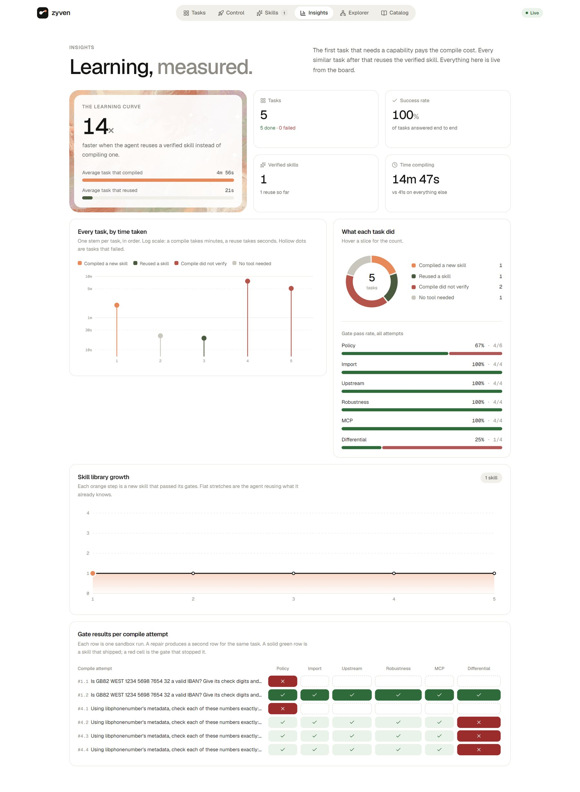

*From an earlier run on an earlier build; the page still looks like this with newer data.*

**Repository explorer.** What could a repository become? Here it is networkx: 102,639 lines in 309 modules, 9,707 tests
in 505 files, and 2,247 symbols, of which an estimated 1,454 could become MCP tools. It is static analysis only, so
nothing is executed. The interactive module graph lets you zoom, pan, drag, search, and click a module to see what it
imports and what imports it.

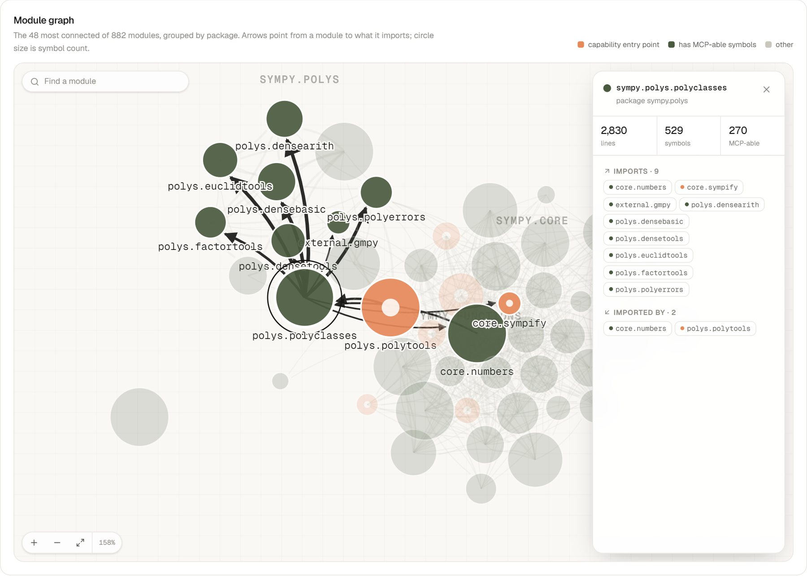

**Skill library.** Every verified skill is kept with its tools, call health, provenance (repository and pinned
commit) and exactly which of the six gates it passed, so the next task can reuse it.

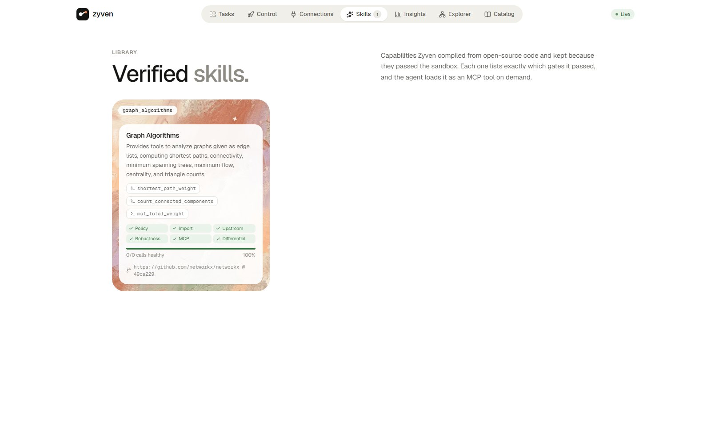

**Catalog.** The pinned repositories Zyven may compile from: reviewer-curated, commit-pinned, licenses recorded, and
nothing outside the list is ever fetched. Adding one is an entry in `catalog/repos.json` and a `zyven sync`.

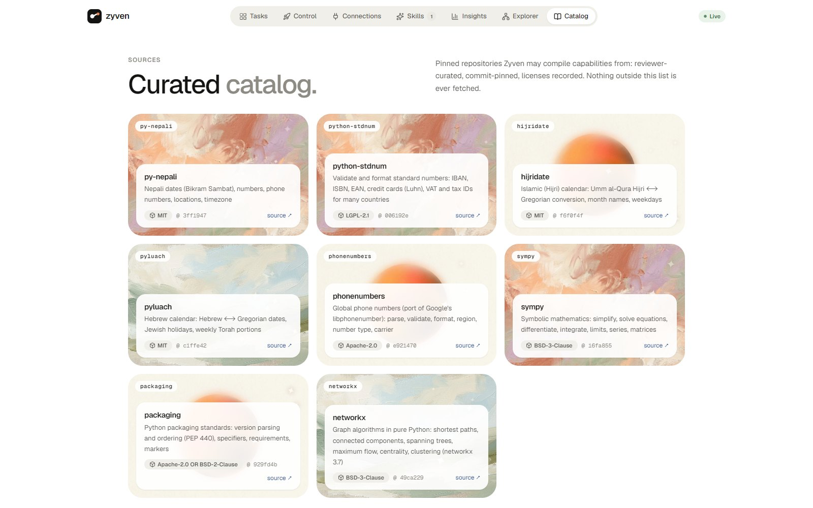

**Control center, connections and the hub (optional extras).** Beyond the task board, the Control center runs work
on other runtimes and shows each run live (output, tool calls, token use, the files it changed). Everything below is
off until you switch it on, and none of it is used for any result in this README.

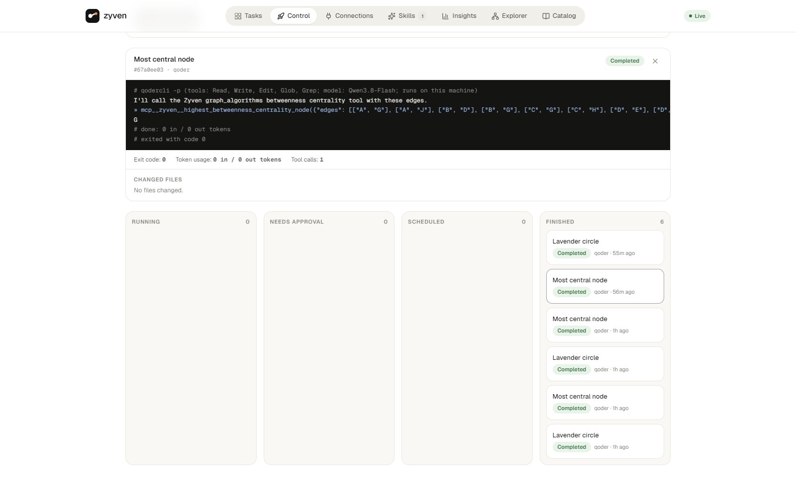

*A run on the Qoder CLI runtime, given Zyven's tools through the hub. It called the verified graph tool and answered G.*

| Runtime | What it is | Checked |
|---|---|---|
| Zyven agent | the built-in agent above, using the model in `.env` | yes |
| Docker command | one shell command in a locked-down container (network off by default) | yes |
| GitHub | create a repository or issue with `gh`, after you approve the exact command | unit tests only; no real `gh` call yet |
| Codex | `codex exec` headless, in Codex's own sandbox | live, on Windows |
| OpenCode | `opencode run` headless, locked to its task folder | live, on Windows |
| Qoder CLI | `qodercli -p` headless, built-in tools limited to read and edit, hub tools through a config file | live, on Windows (Qwen3.8-Flash; model host not verified) |
| Claude Code | `claude -p` headless | unit tests only; not logged in on the dev machine |
| Antigravity | `agy` print mode | experimental: its headless mode printed one line and then waited, so runs stop after 2 minutes of silence |

The coding agents use whatever provider each program is signed in to (for example a ChatGPT account for Codex) or the
free hosted models OpenCode offers. They are labelled as not verified open-weight. You turn each one on, and pick a
model, from the Control center page.

- **Connections.** (screenshot below) Connect any MCP server by URL or local command, or sign in through a service's own page (OAuth with
  PKCE; tokens stay in a local file that the API never returns and that refreshes silently). Test a connection to see
  its real tools. A tool its server does not mark read-only asks for your approval before it runs. Notion's hosted
  server was tested live (sign-in, a read, and a write that was denied). Google Docs, Gmail and Slack's hosted
  servers have templates; Google Docs connected and listed its tools, while Gmail and Slack were not run against the
  real services (Slack refuses automatic app registration and needs its own app).

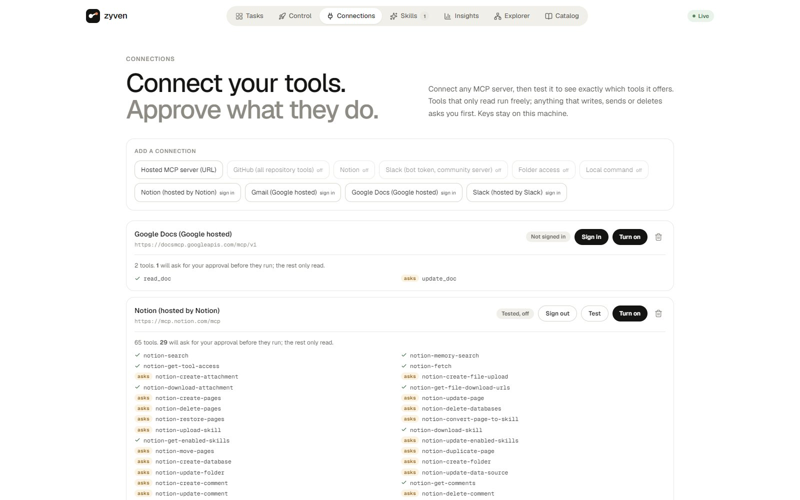
- **The Zyven hub.** A task started on Codex or OpenCode can be given "Zyven's tools": the board serves an MCP endpoint
  (`/hub/mcp`) with a short-lived token per run, offering your enabled connections and your verified skills. The agent
  needs no model key from Zyven. Anything that changes something raises an approval card with its exact arguments, and
  the agent's call waits for your click. Tested live with Codex and OpenCode against Notion, and with Codex using a
  verified Docker skill (IBAN validation, compiled earlier by `gemma-4-26b-a4b-it`): two calls, correct answers, 24 s
  for the whole task including the container start.
- **Approvals.** Denial, a one-hour timeout, a cancel and a restart all mean no.
- **Getting results out.** Download a file or a zip from a finished run, open its folder, or copy its files into one
  export folder you choose (in a new subfolder, never overwriting).
- **Full PC access (no sandbox).** Off. It needs `ZYVEN_ALLOW_FULL_ACCESS=1` on the machine and then a per-task
  confirmation, works only for Codex, OpenCode and Claude Code, cannot repeat on a schedule, and is badged on the run.
- **Local only.** The board has no login. It refuses requests whose `Host` is not this machine and changing requests
  from other websites. See `LIMITATIONS.md` for what that does not cover.

## How it works

```
repo ──► Analyzer (AST, never executes repo code) ──► Scout (AI) ──► Architect (AI) ──► Compiler (AI) ──► Tester (AI)
          symbols, call graph, tests,                   which          tools, params,     tool bodies     library-reference
          doctests, side effects, license               capabilities   boundary, tests                    test cases (never
                                                                                                          sees the adapter)
                                         ▼
            Harness assembles the MCP server (signatures, per-tool imports, docstrings) + static policy check
                                         ▼
   Sandbox gates (Docker: no network · non-root · read-only · capabilities dropped · resource limits)
   policy · import · upstream tests · input robustness · MCP smoke · differential vs. library
                                         ▼
        fail ──► Repair (AI, bounded) ──► re-verify ──► still failing tools are dropped and recorded
        pass ──► skill package: server.py · capability.json · provenance.json · validation-report.json
```

**The model proposes; the harness decides.**
- Every symbol the model names is resolved against the static analysis.
- Generated code is policy-checked before it runs.
- Verified skills also run in the sandbox when the agent uses them, not only during verification.
- Only observed sandbox results mark a skill as verified, and only for the named checks.

The self-extending agent wraps this pipeline:
1. A gap check decides whether the agent's current tools are enough.
2. A capability match picks a source from the pinned catalog.
3. A human approval comes before anything is compiled.
4. The skill library stores verified skills with their provenance and call health.

## Quick start

### Install (no clone)

You need [uv](https://docs.astral.sh/uv/) (or pipx) and Docker. You don't need a model key: coding agents, `verify`
and `mcp` work without one.

```bash
uvx --from git+https://github.com/VirajSawad1021/Zyven zyven setup     # builds the sandbox image, creates ~/.zyven
uvx --from git+https://github.com/VirajSawad1021/Zyven zyven doctor    # what is ready, what is missing, how to fix it
uvx --from git+https://github.com/VirajSawad1021/Zyven zyven verify -- npx -y @modelcontextprotocol/server-memory
```

Or install it once with `pipx install git+https://github.com/VirajSawad1021/Zyven` (or `uv tool install ...`) and run
`zyven setup`, `zyven doctor`, `zyven board` and so on. An installed copy keeps everything in `~/.zyven`, or
`ZYVEN_HOME` if set: the board, the skill library that `zyven mcp` serves, and the settings file `~/.zyven/.env`.
`zyven doctor` warns when the sandbox image is older than the files it was built from, because gates run on a stale
image can give wrong results.

### From a clone (development)

Requirements:
- Python 3.11+ and [uv](https://docs.astral.sh/uv/)
- Docker
- Node 20+, to build the site
- for the chat-model roles: an API key for an OpenAI-compatible host (published results use open-weight models)

```bash
git clone https://github.com/VirajSawad1021/Zyven.git && cd Zyven
uv sync
cp .env.example .env                          # set MODEL_API_KEY (optional with --agent codex)
uv run zyven setup                            # build the sandbox image
uv run zyven sync                             # clone the pinned catalog repos
cd web && npm ci && npm run build && cd ..    # build the site (optional: there is a no-build fallback)
uv run zyven board                            # http://127.0.0.1:8765
```

Open `http://127.0.0.1:8765/app/` and click one of the example tasks.

### Command line

```bash
uv run zyven analyze path/to/repo             # deterministic analysis + rules-only baseline
uv run zyven scout   path/to/repo             # AI: capabilities worth compiling
uv run zyven compile path/to/repo --capability <name>
uv run zyven compile path/to/repo --capability iban --entry stdnum.iban.validate   # reviewer-set boundary
uv run zyven sync --scout                     # clone the catalog and cache the Scout's capabilities
uv run zyven board --port 8765                # board, site and APIs
uv run zyven reassemble --dry-run             # which skills an improved harness would rebuild (no model calls)
uv run zyven reassemble                       # rebuild them; all six gates rerun, the old server kept on failure

uv run python eval/run_eval.py --suite stdnum --limit 6 --label compiled --skill skills/<name>/server.py
uv run python eval/run_eval.py --suite global --limit 6 --label compiled --skill skills/<name>/server.py
```

### Coding agents as the compiler

Any of the five roles can be done by a coding agent run headless instead of the chat model in `.env`: **Codex**,
**Claude Code**, **Antigravity** (`agy`), **OpenCode** or the **Qoder CLI**. The agent writes the spec, the adapter, the
tests or the repair; Zyven's gates still decide what ships. Any agent writes the tools, and Zyven proves they work.

```bash
uv run zyven compile path/to/repo --capability <name> --agent codex                 # Codex does every role
uv run zyven compile path/to/repo --capability <name> --compiler claude:opus        # one role only
uv run zyven compile path/to/repo --capability <name> --compiler codex --tester qoder   # tests from a different vendor
```

Each agent runs in a fresh empty folder with its tools cut to the minimum (Codex read-only sandbox, Claude Code with no
tools, OpenCode with every permission denied) and answers in text. Its answer goes through the same schema validation,
reference resolution, policy check and six sandbox gates as a chat model's. `provenance.json` records who did each role
(`"roles"`). An agent uses its own sign-in, so the code and prompts go to whichever provider it is signed in to.

First run (2026-11-06, not part of the published numbers): `--agent codex` on pypa/packaging `version_specifiers`
was **verified on the first attempt in 163 s**: 4 tools, 2,108 upstream tests, 6/6 robustness probes, MCP smoke,
12/12 differential cases. The run before it failed the policy gate and so found an analyzer bug: a stray
`tasks/__init__.py` hid packaging's `src/` layout, so imports read `src.packaging...`. The analyzer now prefers
the package `pyproject.toml` names.

### Use verified skills from Claude Code, Codex or any agent

`zyven mcp` serves the verified skills in your library as a plain stdio MCP server. The coding agent starts it
itself, so the board does not have to be running:

```bash
uv run zyven mcp --print-config            # prints the exact commands below for this machine
claude mcp add --scope user zyven -- <python> -m zyven.cli mcp --board-dir <board>/      # Claude Code
codex mcp add zyven -- <python> -m zyven.cli mcp --board-dir <board>/                    # Codex
```

Each skill runs in its Docker sandbox, as on the board. The tools are marked read-only, so agents can call them without
asking. `--skill NAME` limits what is offered. `--connections` also offers the services connected on the board (Notion,
GitHub, ...); with no board there are no approval cards, so a tool that changes something is then guarded only by your
agent's own permission prompt.

Tested with Codex headless and no board running. Asked "does 1.0.0rc1 satisfy `>=1.0`, and which of 2.0.0, 2.0.0b3,
1.9.12 is newest?", it called `check_version_requirement` and `sort_versions` and answered correctly. The first answer
is *no*: PEP 440 leaves pre-releases out by default.

### Verify any MCP server

`zyven verify` checks an MCP server Zyven did not build, from the outside: a command over stdio or a URL.

```bash
uv run zyven verify -- npx -y @modelcontextprotocol/server-everything      # a command (runs on this machine)
uv run zyven verify --url https://example.com/mcp --header "Authorization: Bearer ..."
uv run zyven verify --probe --lock mcp-lock.json -- python my_server.py    # also send invalid input; pin definitions
uv run zyven verify --docker zyven-sandbox:py312 --mount ./skill:/skill -- python /skill/server.py   # in the sandbox
```

| Check | Fails when |
|---|---|
| handshake | the server does not start, finish the MCP handshake or list its tools in time |
| schemas | a tool name is invalid or repeated, or an input/output schema is not valid JSON Schema |
| descriptions | a name, description or parameter carries **tool poisoning**: invisible Unicode (decoded and shown), `<IMPORTANT>` blocks, "do not tell the user", requests to read `~/.ssh` or send data to a URL |
| annotations | a tool is marked both read-only and destructive (a missing `readOnlyHint` is a warning) |
| stability | the tool definitions change between two connections, or differ from the lock file (a **rug pull**) |
| robustness | with `--probe`: input the tool's own schema forbids is accepted, or the server stops answering |
| isolation | a warning, not a failure, when the server ran on this machine instead of in the sandbox |

Nothing is called unless `--probe` is given, and probes only send input the schema rejects. A stdio server gets only a
minimal environment (`--env NAME` passes a variable through), so your shell's secrets are not handed to it. It still
runs with your permissions, so use `--docker` for code you do not trust. Zyven's own compiled skills pass every check
with no warnings: they declare themselves read-only and carry parameter descriptions in their schemas.

The official reference servers, checked on 2026-11-06 with `--probe` inside the sandbox (`node:22-slim`, no network).
Each was installed with `npm install --ignore-scripts` and mounted read-only:

| Server (npm, v1.0.0) | Tools | Verdict | Warnings |
|---|---|---|---|
| `@modelcontextprotocol/server-everything` | 13 | PASS | 1 tool with an undocumented parameter |
| `@modelcontextprotocol/server-filesystem` | 14 | PASS | 12 tools with undocumented parameters (e.g. `read_file.path`) |
| `@modelcontextprotocol/server-memory` | 9 | PASS | 4 tools with undocumented parameters |
| `@modelcontextprotocol/server-sequential-thinking` | 1 | PASS | a 2,781-character description (worth reading) |

All of them had valid schemas, no poisoning, correct annotations and the same definitions on a second connection. They
also rejected every invalid probe: 54 in all.

Fifteen popular community servers, checked the same way on 2026-11-06. This is what `zyven verify` reports, not a
security audit. Warnings are quality findings, not vulnerabilities. Servers that must reach their service to start ran
with `--allow-network`, and their reports say so. Each got dummy API keys, so nothing real was accessed.

| Server (npm) | Tools | Verdict | Warnings |
|---|---|---|---|
| `@playwright/mcp` 0.0.84 | 25 | PASS | none |
| `@browsermcp/mcp` 2.4.0 | 1 | PASS | none |
| `@upstash/context7-mcp` 4.5.0 | 2 | PASS | one 2,006-character description |
| `firecrawl-mcp` 3.37.0 | 28 | PASS | 23 tools with undocumented parameters; one long description |
| `@notionhq/notion-mcp-server` 2.6.1 | 24 | PASS | 12 tools with undocumented parameters; 12 without a read-only hint |
| `tavily-mcp` 0.2.22 | 5 | PASS | no read-only hints |
| `@brave/brave-search-mcp-server` 2.1.4 | 8 | PASS | no read-only hints |
| `exa-mcp-server` 3.4.3 | 3 | PASS | 1 tool with an undocumented parameter |
| `@wonderwhy-er/desktop-commander` 0.3.1 | 25 | PASS | 20 tools with undocumented parameters; 8 descriptions of 2,000-6,135 characters |
| `@executeautomation/playwright-mcp-server` 1.0.12 | 33 | PASS | no read-only hints |
| `@sentry/mcp-server` 0.48.0 | 73 | PASS | 66 tools with undocumented parameters; one long description |
| `@heroku/mcp-server` 1.2.13 | 33 | PASS | no read-only hints |
| `@supabase/mcp-server-supabase` 0.16.0 | 31 | PASS (network) | 26 tools with undocumented parameters |
| `figma-developer-mcp` 0.13.2 | 2 | PASS (network) | 1 of 2 tools without a read-only hint |
| `mcp-server-kubernetes` 4.2.1 | - | inconclusive | did not start in the sandbox, even with network (it likely needs a cluster config) |

None showed tool poisoning or a changed tool list, and every server that started rejected all invalid probes. Without
read-only hints, a client must ask before every call. Undocumented parameters leave the model guessing. Very long
descriptions cost context on every request and are hard for a person to review.

The scan also improved `verify`. desktop-commander writes the container's host name into a tool description, so two
sandbox runs first looked like a rug pull. Every sandbox container now has the same host name, `zyven-sandbox`.

### Agents and connectors (optional)

Everything here is off by default. In the Control center page (`/app/control/`), select a runtime, press **Turn on**
and optionally set a model. Environment variables also work (`ZYVEN_ENABLE_CODEX=1`, `ZYVEN_ENABLE_OPENCODE=1`,
`ZYVEN_ENABLE_CLAUDE=1`, `ZYVEN_ENABLE_AGY=1`, `ZYVEN_ENABLE_QODER=1`, `ZYVEN_ENABLE_GITHUB=1`). Each program must be installed
and signed in by itself (`codex login`, `opencode auth login`, and so on); the page shows "installed / signed in" for each.

The **Qoder CLI** runtime runs `qodercli` headless with no shell or web tools, and can be given Zyven's verified tools
through the hub. Pick the model on the Control center page (the demo used a Qwen model); Zyven does not verify which
weights or host answer, so Qoder results are not part of the published numbers. If `qodercli` is not on `PATH`, set
`ZYVEN_QODERCLI` to its path.

Two switches stay environment-only on purpose, so they cannot be turned on from the web page:
`ZYVEN_ALLOW_STDIO_CONNECTORS=1` (connectors that start a local command) and `ZYVEN_ALLOW_FULL_ACCESS=1` (tasks
without a sandbox). `ZYVEN_ALLOWED_HOSTS` adds host names the board answers to, if you serve it on purpose beyond
this machine. On the Connections page, add a service, press **Test**, then **Turn on**.

### Working on the frontend

The site is a Next.js static export in `web/`. The board server mounts `web/out`. Without a build, `/` falls back
to a single-file page, which is also always available at `/legacy`.

```bash
cd web
npm run dev                                   # http://localhost:3000, proxies /api to the board
                                              # (set ZYVEN_API to point at another board)
```

## Working on large repositories

- **Tests:** pytest runs unittest suites, `*.doctest` files and docstring examples. The gates report how many
  doctest examples were actually checked.
- **Digest folding:** families of modules that share one API are folded for the model. For python-stdnum this cuts
  182k characters to 37k, with 237 validator modules in one block.
- **Human-set boundaries:** `--entry` overrides the Scout's choice of entry points.
- **Any layout:** packages under `src/` or another subfolder are detected and used as the import root in the
  analyzer, the sandbox and the skill runtime.
- **Tests the sandbox can't run** (they import packages that aren't installed, e.g. `bs4`) are skipped with the
  reason recorded, never silently counted.

## Repository layout

| Path | Contents |
|---|---|
| `zyven/analysis/` | analyzer, rules-only miner and digests, reference resolution, repo explorer |
| `zyven/ai/` | model provider (retries, failover), coding agents as providers (`agent_provider.py`), typed schemas, AI roles |
| `zyven/compiler/` | server assembly, static policy, verification gates, compile pipeline |
| `zyven/mcpverify/` | `zyven verify`: outside-in checks for any MCP server (schemas, tool poisoning, rug pulls, robustness) |
| `zyven/sandbox/` | Docker runner, image, in-container MCP smoke and differential test runners |
| `zyven/agent/` | MCP toolbox, tool-using agent loop, gap check, self-extending agent |
| `zyven/catalog/` | the pinned catalog: clone, scout, curate |
| `zyven/memory/` | skill library: verified skills, provenance, call health |
| `zyven/connections/` | connected MCP servers: local secret store, OAuth sign-in, tool listing, templates |
| `zyven/hub/` | the Zyven hub: connected services and verified skills offered to coding agents over MCP |
| `zyven/orchestrator/` | board server: tasks, approvals, SSE, explorer API; Control center, runtime adapters (Docker, GitHub, Codex, OpenCode, Qoder CLI, Claude Code, Antigravity), local-only guard |
| `web/` | Next.js site and board UI (static export served by the board) |
| `toolkit/` | hand-written reference skill (baseline) |
| `eval/` | task suites, before/after runner, results |
| `catalog/repos.json` | pinned source repositories, commits and licenses |
| `scripts/` | offline checks: open-weight model policy, control-center smoke test |
| `docs/` | demo script, narration text, animated explainer slides (`docs/demo/`), screenshots |

## Models and sources

The published results above use open-weight models only, end to end. The endpoint is configurable: Google AI Studio
(Gemma), OpenRouter, Groq or a local Ollama, with automatic failover to a backup host. Closed models and coding agents
work too (see [Coding agents as the compiler](#coding-agents-as-the-compiler)); they are labelled in provenance and kept
out of the published numbers.

| Repo | Commit | License | Used as |
|---|---|---|---|
| [arthurdejong/python-stdnum](https://github.com/arthurdejong/python-stdnum) | `006192e` | LGPL-2.1 | wrapped (imported, not copied) |
| [dralshehri/hijridate](https://github.com/dralshehri/hijridate) | `f6f0f4f` | MIT | wrapped (imported, not copied) |
| [simlist/pyluach](https://github.com/simlist/pyluach) | `c1ffe42` | MIT | wrapped (imported, not copied) |
| [daviddrysdale/python-phonenumbers](https://github.com/daviddrysdale/python-phonenumbers) | `e921470` | Apache-2.0 | wrapped (imported, not copied) |
| [opensource-nepal/py-nepali](https://github.com/opensource-nepal/py-nepali) | `3ff1947` | MIT | wrapped (imported, not copied) |
| [sympy/sympy](https://github.com/sympy/sympy) | `16fa855` | BSD-3-Clause | wrapped (imported, not copied) |
| [pypa/packaging](https://github.com/pypa/packaging) | `929fd4b` | Apache-2.0 OR BSD-2-Clause | wrapped (imported, not copied) |
| [networkx/networkx](https://github.com/networkx/networkx) | `49ca229` | BSD-3-Clause | wrapped (imported, not copied) |

The pinned list lives in `catalog/repos.json`.

The default model is `gemma-4-26b-a4b-it`, distributed under the
[Gemma Terms of Use](https://ai.google.dev/gemma/terms). The repository keeps committed results open-weight with a
deterministic, offline check (it flags closed models and coding agents, including one used for a single role):

```bash
uv run python scripts/check_open_models.py
```

It scans committed config, skill provenance and eval reports, and runs in CI on every pull request.

## Documentation

- **[Architecture](ARCHITECTURE.md)**: System design, subsystems, end-to-end execution flow, and trust boundaries.
- **[AI Usage Disclosure](AI_USAGE.md)**: Complete inventory of every file and function where open-weight model outputs are programmatically consumed and validated.
- **[Scope & Limitations](LIMITATIONS.md)**: What multi-gate verification proves, what it does not prove, and system boundaries.

## Status and roadmap

The capability compiler, the self-extending agent and the board work end to end. Added since the competition:
- coding agents as compile roles
- `zyven verify` for any MCP server
- `zyven mcp` for Claude Code, Codex and other agents
- install with `uvx`/`pipx`, plus `setup` and `doctor`
- `zyven reassemble`

Open work is tracked in [issues](https://github.com/VirajSawad1021/Zyven/issues):

- [#7](https://github.com/VirajSawad1021/Zyven/issues/7) Re-run every result with the final open-weight model
  (`scripts/check_open_models.py` now enforces the policy)
- [#8](https://github.com/VirajSawad1021/Zyven/issues/8) Learning-curve evaluation (skills learned once, reused later)
- [#9](https://github.com/VirajSawad1021/Zyven/issues/9) Interface lint: measure the effect of the merged related-facts rule
- [#24](https://github.com/VirajSawad1021/Zyven/issues/24) Evaluation: add a model + Python interpreter baseline
- [#25](https://github.com/VirajSawad1021/Zyven/issues/25) Evaluation: held-out suite and run-to-run variance
- [#26](https://github.com/VirajSawad1021/Zyven/issues/26) Catalog: real-world libraries beyond pure calculators (packaging and networkx added; more to come)
- [#27](https://github.com/VirajSawad1021/Zyven/issues/27) Demo video: done, linked at the top of this README

Known gaps in the optional extras: Claude Code and the GitHub connector have not been run against the real services;
Antigravity's headless mode does not work on the development machine; Gmail and hosted Slack sign-in were not run
against the real services; the Qoder CLI runtime was checked with a Qwen model whose host and exact weights are not
verified; and everything was checked on Windows only. `LIMITATIONS.md` lists the trust assumptions.

## License

MIT
