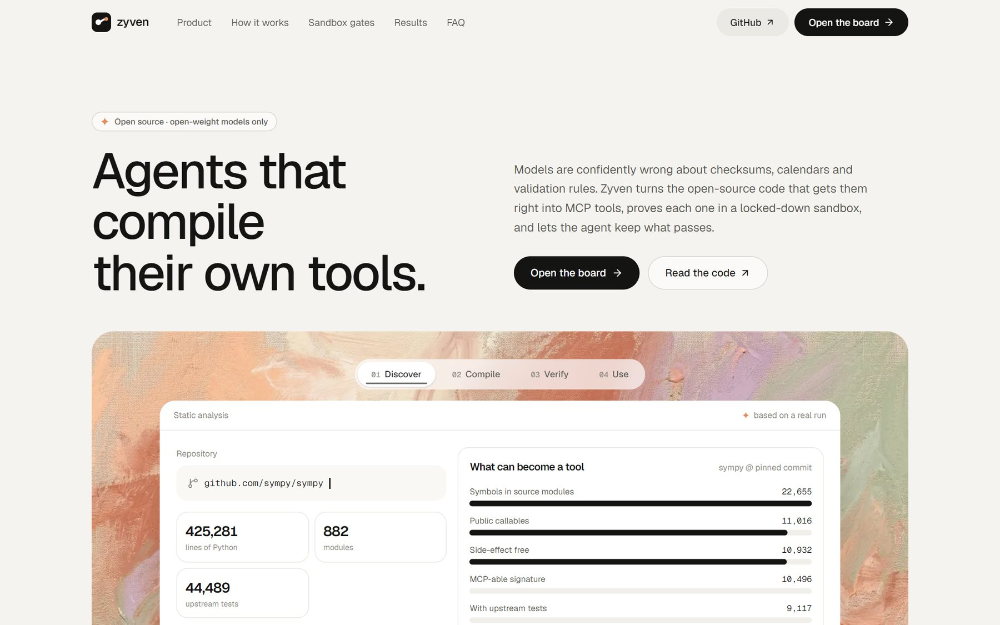
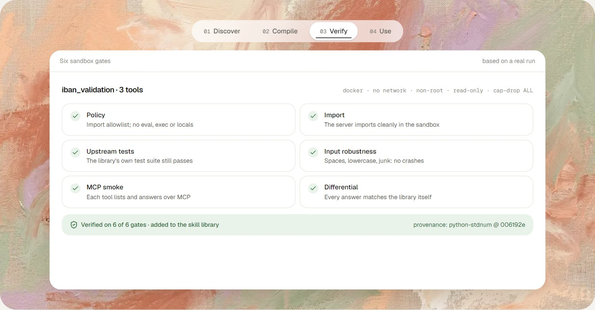
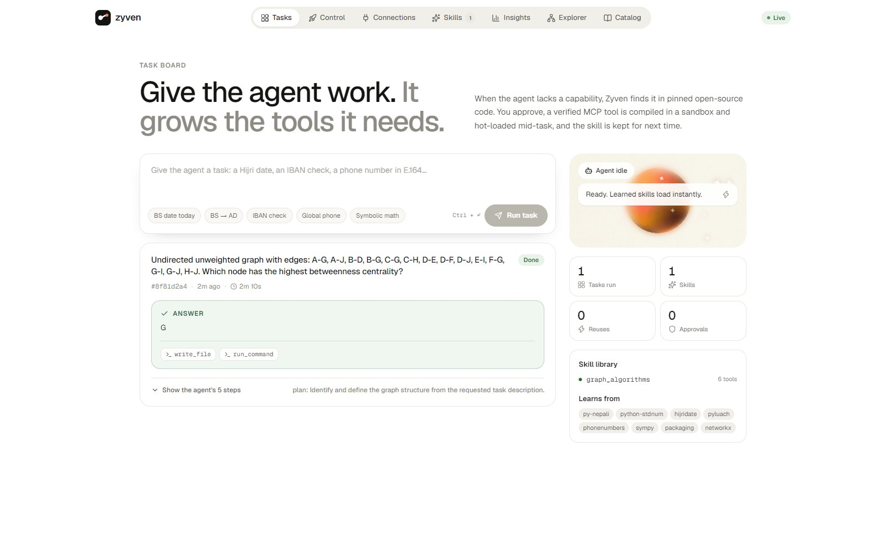
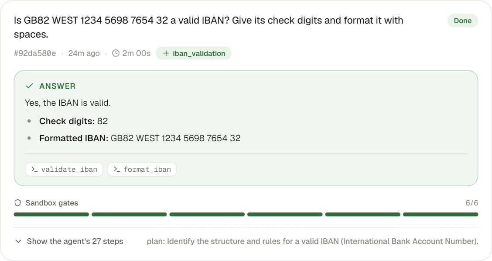
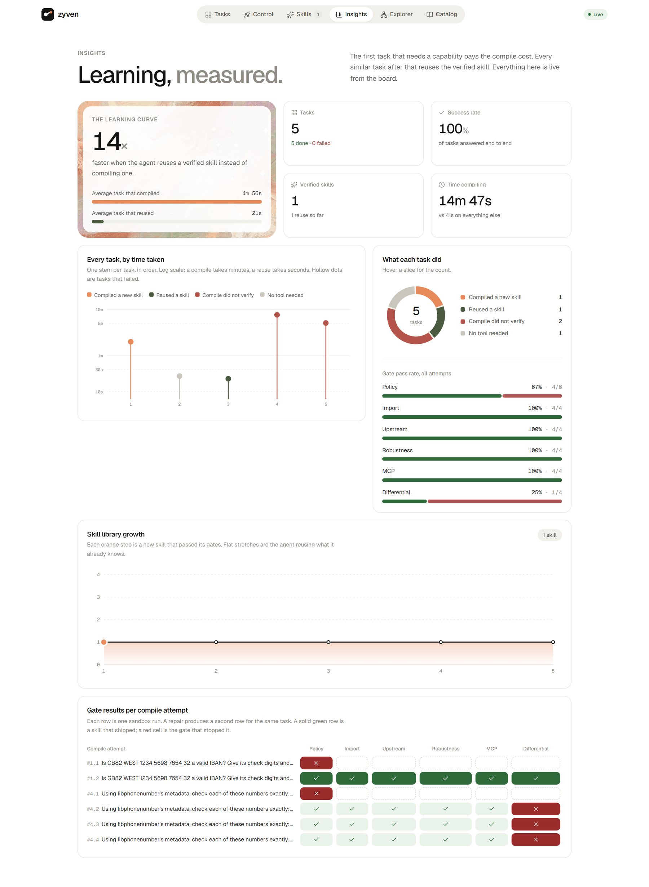
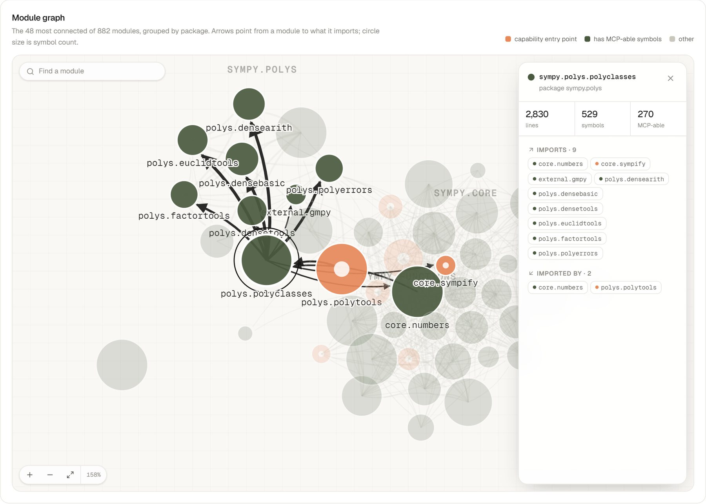

<div align="center">

# Zyven

**Agents that compile their own tools.**

Zyven turns open-source code into verified MCP tools that an AI agent learns when it needs them, and keeps
only after they pass a locked-down sandbox.

[](https://github.com/VirajSawad1021/Zyven/actions/workflows/ci.yml)


Frogtoberfest 2026 entry



</div>

## Why

Language models are confidently wrong about things that need exact logic: check digits, calendar conversions,
validation rules, lookups. The correct, tested code for these already exists in open-source libraries, but an agent
can't use it until someone hand-builds a tool around it.

Zyven does that step automatically, and refuses to hand over anything it can't prove:

1. **Discover.** Read a repository's source with static analysis, never running it: public functions, call graph,
   tests, side effects, license.
2. **Compile.** Open-weight model roles propose a small MCP server around the library. Every name they write is
   checked against the analysis, so invented functions are rejected.
3. **Verify.** Six gates run in a Docker sandbox with no network. One of them compares every tool's answer with the
   library called directly.
4. **Use.** The agent hot-loads the verified skill mid-task and keeps it. The next task that needs it reuses it in
   seconds instead of compiling for minutes.



## Results

Every run uses the open-weight model `gemma-4-26b-a4b-it`, with the same tasks and budget in each condition. Ground
truth is computed by the source library itself, and the raw records are in `eval/results/`.

The table below is from single-run measurements. New runs can use `--repeat 3` to report
mean ± half-range and record the model, host and requested seed for every run. The held-out
suite remains a separate experiment.

| Suite | Source | Model alone | Model + Zyven-compiled skills |
|---|---|---|---|
| IBAN validity, IBAN check digits, Luhn | [python-stdnum](https://github.com/arthurdejong/python-stdnum) | **0 / 18** | **18 / 18** |
| Hijri ↔ Gregorian, Jewish holidays, phone validity and E.164 | [hijridate](https://github.com/dralshehri/hijridate), [pyluach](https://github.com/simlist/pyluach), [phonenumbers](https://github.com/daviddrysdale/python-phonenumbers) | **18 / 30** | **27 / 30*** |
| Bikram Sambat dates, weekdays, phone operators | [py-nepali](https://github.com/opensource-nepal/py-nepali) | **9 / 40** | **40 / 40** |

<details>
<summary>Per-category breakdown</summary>

**python-stdnum** (366 modules)

| Condition | IBAN valid? | IBAN check digits | Card number passes Luhn? | Total |
|---|---|---|---|---|
| Model alone | 0/6 | 0/6 | 0/6 | **0/18** |
| Model + compiled skills | 6/6 | 6/6 | 6/6 | **18/18** |

**Calendars and phone numbers**

| Condition | Hijri → Greg | Greg → Hijri | Jewish holiday | Phone valid? | Phone → E.164 | Total |
|---|---|---|---|---|---|---|
| Model alone | 2/6 | 3/6 | 3/6 | 5/6 | 5/6 | **18/30** |
| Model + compiled skills | 6/6 | 6/6 | 3/6* | 6/6 | 6/6 | **27/30** |

**py-nepali** (Bikram Sambat calendar)

| Condition | Date conversions · weekday · phone operator | Total |
|---|---|---|
| Model alone | 2/10 · 0/10 · 1/10 · 6/10 | **9/40** |
| Model + hand-written skill | 10/10 each | **40/40** |
| Model + compiled skills | 10/10 each | **40/40** |

</details>

\*There was no Jewish-holiday skill in this run: the hosted endpoint timed out on that compile, so that category ran
without a skill in both conditions. Details are in `eval/results/global-open-model.md`.

Without tools, the model tries to compute checksums and calendars by hand and usually runs out of budget.

### What the gates caught during development

- **Differential gate:** merged imports in a generated server made the "Luhn" tool silently run a different
  checksum algorithm. Every other gate passed. The comparison with the library failed 3 of 8 cases, and the build
  now scopes imports per tool.
- **Input robustness:** a card-number tool crashed on `4992 7398 71` (with spaces). The Repair role fixed it.
- **Partial verification:** an IBAN check-digit tool that could not be repaired was dropped from the package
  instead of being shipped unverified.

## The app

`zyven board` serves the landing page, the board and the APIs on one port. The screenshots below are the real app
on a clean board (`zyven board --board-dir …`) where every model call was made by the open-weight
`gemma-4-26b-a4b-it`.

**Task board.** Give the agent a task. When it lacks a capability it proposes a pinned repository, waits for your
approval, compiles in the sandbox and finishes the task with the new tool. Below, the first IBAN task compiled a skill
from python-stdnum (366 modules) in 2 minutes. The second reused it and finished in 19 seconds. A UK phone number the
model could answer on its own needed no tool at all.



**A finished task.** The answer, the tool calls that produced it, the skill learned from the repository, and the six
sandbox gates it passed. Answers render as Markdown, with maths when there is any.

<p align="center"></p>

**Insights.** The learning curve, measured: how much faster a reuse is than a compile, every task on a log-scale
timeline, skill-library growth, and a grid of which gate stopped each compile attempt. In this run, a phone-number skill
compiled from python-phonenumbers passed the library's own 158 tests, but the differential gate caught one tool
disagreeing with the library on a UK mobile number. Two repairs didn't fix it, so the skill was not loaded.



**Repository explorer.** What could a repository become? Here it is sympy, 425,281 lines in 882 modules, analysed
statically in about 100 seconds. It shows the funnel from every symbol to MCP-able tool candidates, and an
interactive module graph: zoom, pan, drag, search, and click a module to see what it imports and what imports it.



**Skill library.** Every verified skill is kept with its tools, call health, provenance (repository and pinned
commit) and exactly which of the six gates it passed, so the next task can reuse it.

## How it works

```
repo ──► Analyzer (AST, never executes repo code) ──► Scout (AI) ──► Architect (AI) ──► Compiler (AI) ──► Tester (AI)
          symbols, call graph, tests,                   which          tools, params,     tool bodies     library-reference
          doctests, side effects, license               capabilities   boundary, tests                    test cases (never
                                                                                                          sees the adapter)
                                         ▼
            Harness assembles the MCP server (signatures, per-tool imports, docstrings) + static policy check
                                         ▼
   Sandbox gates (Docker: no network · non-root · read-only · capabilities dropped · resource limits)
   policy · import · upstream tests · input robustness · MCP smoke · differential vs. library
                                         ▼
        fail ──► Repair (AI, bounded) ──► re-verify ──► still failing tools are dropped and recorded
        pass ──► skill package: server.py · capability.json · provenance.json · validation-report.json
```

**The model proposes; the harness decides.**
- Every symbol the model names is resolved against the static analysis.
- Generated code is policy-checked before it runs.
- Verified skills also run in the sandbox when the agent uses them, not only during verification.
- Only observed sandbox results mark a skill as verified, and only for the named checks.

The self-extending agent wraps this pipeline:
1. A gap check decides whether the agent's current tools are enough.
2. A capability match picks a source from the pinned catalog.
3. A human approval comes before anything is compiled.
4. The skill library stores verified skills with their provenance and call health.

## Quick start

Requirements:
- Python 3.11+ and [uv](https://docs.astral.sh/uv/)
- Docker
- Node 20+, to build the site
- an API key for a host serving an open-weight model

```bash
git clone https://github.com/VirajSawad1021/Zyven.git && cd Zyven
uv sync
cp .env.example .env                          # set MODEL_API_KEY; the model must be open-weight
docker build -t zyven-sandbox:py312 zyven/sandbox
uv run zyven sync                             # clone the pinned catalog repos
cd web && npm ci && npm run build && cd ..    # build the site (optional: there is a no-build fallback)
uv run zyven board                            # http://127.0.0.1:8765
```

Open `http://127.0.0.1:8765/app/` and click one of the example tasks.

### Command line

```bash
uv run zyven analyze path/to/repo             # deterministic analysis + rules-only baseline
uv run zyven scout   path/to/repo             # AI: capabilities worth compiling
uv run zyven compile path/to/repo --capability <name>
uv run zyven compile path/to/repo --capability iban --entry stdnum.iban.validate   # reviewer-set boundary
uv run zyven sync --scout                     # clone the catalog and cache the Scout's capabilities
uv run zyven board --port 8765                # board, site and APIs

uv run python eval/run_eval.py --suite stdnum --limit 6 --label compiled --skill skills/<name>/server.py
uv run python eval/run_eval.py --suite stdnum --limit 6 --repeat 3 --interpreter \
  --label compiled --skill skills/<name>/server.py
uv run python eval/run_eval.py --suite global --limit 6 --label compiled --skill skills/<name>/server.py
```

`--interpreter` adds two conditions: Python with the suite library importable, and Python with only
the standard library. It needs Docker and `zyven-sandbox:py312`. Every JSONL record carries the run
number, model, host, requested seed and token counts; `eval/results/run-<stamp>.json` holds the run
configuration.

### Working on the frontend

The site is a Next.js static export in `web/`. The board server mounts `web/out`. Without a build, `/` falls back
to a single-file page, which is also always available at `/legacy`.

```bash
cd web
npm run dev                                   # http://localhost:3000, proxies /api to the board
                                              # (set ZYVEN_API to point at another board)
```

## Working on large repositories

- **Tests:** pytest runs unittest suites, `*.doctest` files and docstring examples. The gates report how many
  doctest examples were actually checked.
- **Digest folding:** families of modules that share one API are folded for the model. For python-stdnum this cuts
  182k characters to 37k, with 237 validator modules in one block.
- **Human-set boundaries:** `--entry` overrides the Scout's choice of entry points.
- **Any layout:** packages under `src/` or another subfolder are detected and used as the import root in the
  analyzer, the sandbox and the skill runtime.
- **Tests the sandbox can't run** (they import packages that aren't installed, e.g. `bs4`) are skipped with the
  reason recorded, never silently counted.

## Repository layout

| Path | Contents |
|---|---|
| `zyven/analysis/` | analyzer, rules-only miner and digests, reference resolution, repo explorer |
| `zyven/ai/` | model provider (retries, failover), typed schemas, AI roles |
| `zyven/compiler/` | server assembly, static policy, verification gates, compile pipeline |
| `zyven/sandbox/` | Docker runner, image, in-container MCP smoke and differential test runners |
| `zyven/agent/` | MCP toolbox, tool-using agent loop, gap check, self-extending agent |
| `zyven/catalog/` | the pinned catalog: clone, scout, curate |
| `zyven/memory/` | skill library: verified skills, provenance, call health |
| `zyven/orchestrator/` | board server: tasks, approvals, SSE, control center, explorer API |
| `web/` | Next.js site and board UI (static export served by the board) |
| `toolkit/` | hand-written reference skill (baseline) |
| `eval/` | task suites, before/after runner, results |
| `catalog/repos.json` | pinned source repositories, commits and licenses |

## Models and sources

Only open-weight models, end to end. The endpoint is configurable: Google AI Studio (Gemma), OpenRouter, Groq or a
local Ollama, with automatic failover to a backup host.

| Repo | Commit | License | Used as |
|---|---|---|---|
| [arthurdejong/python-stdnum](https://github.com/arthurdejong/python-stdnum) | `006192e` | LGPL-2.1 | wrapped (imported, not copied) |
| [dralshehri/hijridate](https://github.com/dralshehri/hijridate) | `f6f0f4f` | MIT | wrapped (imported, not copied) |
| [simlist/pyluach](https://github.com/simlist/pyluach) | `c1ffe42` | MIT | wrapped (imported, not copied) |
| [daviddrysdale/python-phonenumbers](https://github.com/daviddrysdale/python-phonenumbers) | `e921470` | Apache-2.0 | wrapped (imported, not copied) |
| [opensource-nepal/py-nepali](https://github.com/opensource-nepal/py-nepali) | `3ff1947` | MIT | wrapped (imported, not copied) |

The pinned list lives in `catalog/repos.json`.

## Documentation

- **[Architecture](ARCHITECTURE.md)**: System design, subsystems, end-to-end execution flow, and trust boundaries.
- **[AI Usage Disclosure](AI_USAGE.md)**: Complete inventory of every file and function where open-weight model outputs are programmatically consumed and validated.
- **[Scope & Limitations](LIMITATIONS.md)**: What multi-gate verification proves, what it does not prove, and system boundaries.

## Status and roadmap

The capability compiler, the self-extending agent and the board work end to end. Open work is tracked in
[issues](https://github.com/VirajSawad1021/Zyven/issues):

- [#5](https://github.com/VirajSawad1021/Zyven/issues/5) Architecture, AI-usage disclosure and limitations docs
- [#7](https://github.com/VirajSawad1021/Zyven/issues/7) Re-run every result with the final open-weight model
- [#8](https://github.com/VirajSawad1021/Zyven/issues/8) Learning-curve evaluation (skills learned once, reused later)
- [#9](https://github.com/VirajSawad1021/Zyven/issues/9) Interface lint: tools that return related facts

## License

MIT
